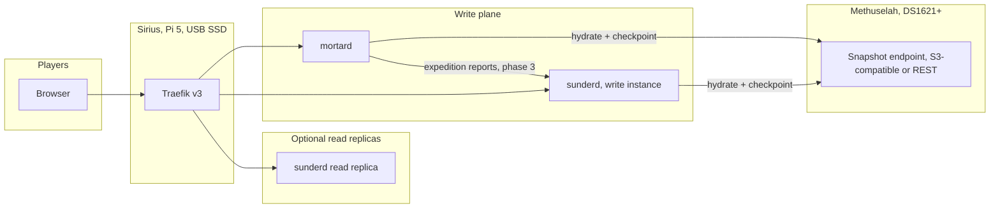

# Twin-Loop Games: Consolidated Design & Red-Team

Consolidated from the Gemini conversation, cross-checked against Carl's existing infrastructure (Arcane fleet, Traefik v3, GHCR multi-arch pipeline, Methuselah NAS), plus an independent red-team pass with concrete fixes.

---

## 1. The concept in one paragraph

Two games sharing one world, deliberately paced at opposite speeds:

- **The Settlement Sim: Mortar** (service daemon `mortard`): a slow, tick-driven, text-first world. Starts as one village next to one dungeon. Players queue actions against the world once per tick; the server resolves everything and publishes a Chronicle. Grows in complexity only as the player population and settlement tier justify new systems.
- **The Dungeon Roguelike: Sunder** (service daemon `sunderd`): a fast, screen-based, procedurally generated dungeon crawler inspired by GBC Dragon Warrior Monsters floor design. Daily shared-seed runs plus unlimited personal runs. Death has teeth: it feeds the dungeon and leaves recoverable remnants for future adventurers.

Each game is fully playable and fun alone; the bridge between them is a phase-3 feature, not a foundation requirement. That ordering is the single most important correction from the red-team pass.

## 2. Core invariants

1. **Server is the source of truth.** Clients send intents (`move`, `attack`, `disarm`, `queue_action`, `extract`), never state. All RNG and validation is server-side.
2. **Zero host-level mounts.** App/game state hydrates on container boot from a remote snapshot endpoint (Methuselah) via Compose environment variables. Adding a node = deploy the image + fill in env vars. Nothing else.
3. **Idle costs zero.** The roguelike persists run state in SQLite and has no loop running between actions. The world sim ticks on a schedule and no-ops when queues are empty.
4. **Actions cost real-world minutes, not ticks.** Action pacing survives tick-rate changes (1/day → every 3h → near real-time) in both the design and the place the player reads the rules.
5. **Ad-free, non-predatory.** Any future supporter tier grants cosmetic/convenience perks only, never leaderboard power.

## 3. System A: the settlement sim (Mortar / `mortard`)

### 3.1 The ΔT action model

Every player action declares its cost in real-world minutes (`scout_perimeter: 45`, `fortify_palisade: 120`). At each tick the engine advances the global clock by the elapsed real time ΔT and consumes queued actions against that budget; partial actions carry progress into the next tick. Changing tick cadence never breaks action costs.

- **Minor ticks**: character queues, movement, harvesting.
- **Major ticks**: settlement stockpiles, dungeon threat, resource regeneration, Chronicle generation.
- **Pacing valve**: configurable `min_tick_interval` / `max_tick_interval`; dynamic throttling is a later optimization, not a v1 requirement.

### 3.2 The catch-up digest

Every meaningful event appends to a per-character, append-only ledger. On login, `GET /v1/character/summary?since=…` rolls unprocessed events into a short narrative ("While you were away: 3 days passed, you harvested 30 timber, and the dungeon grew by a floor.").

### 3.3 Phased world growth

| Phase | Scope | Systems | Explicitly deferred |
|---|---|---|---|
| 1 | 1 village + dungeon 1 (floors 1-3) | Action queue, gathering/fortifying, stockpiles, threat meter, chronicle | Multi-town, trade, taxes |
| 2 | Village → town | Buildings/upgrades, crafting unlocks starting options, breach events | Diplomacy, rival towns |
| 3 | City + frontier villages at dungeon 2+ | One new dungeon at a time, each with its own hazard profile and loot table | Cross-region trade until real population demands it |

## 4. System B: the dungeon roguelike (Sunder / `sunderd`)

### 4.1 Floor and screen generation

- Each floor is a grid of "screens" (DWM-style screen-to-screen traversal), with a per-floor theme (Sunken Crypt, Cinder Warrens, …) that drives entity and hazard spawn tables.
- Descent via holes; ascent via stairs you must find and trek back to. Stairway landings are safe rooms: organize inventory, use items, no combat.
- Escaping requires a rare exit item, a milestone floor (every 5th / pre-boss), or the long climb back up. Leaving must never be free.
- Runs use a fresh seed by default; daily/weekly shared-seed runs for leaderboards.
- Later: multiple colored exits on floor 1, branching into distinct "floor 2s", with lock-in objectives so peeking isn't risk-free.

### 4.2 Risk and reward

- Loot stays at risk until banked at the settlement (extract-or-die).
- Dying feeds the dungeon's threat counter and may drop a **Corpse Remnant**: an item keyed to the death cause (pit trap, specific enemy) plus a short auto-generated epitaph.
- A future run that detects/avoids that trap or defeats that enemy type on that floor has a chance to find the remnant. Claims are atomic (`WHERE claimed_by_run_id IS NULL`), reserved-then-consumed at banking, never duplicable; a claimer's own death returns the remnant to the pool.

### 4.3 Presentation

Server-rendered HTML/CSS, compact grid + text log. No art asset production is on the critical path, ever. A graphical layer can be built on top of the exact same server-validated run state later.

## 5. Cross-game bridge (phase 3)

- `sunderd → mortard`: idempotent expedition reports (keyed by run id + event id) on banking/extraction/death: banked resources, kills by species, depth reached, threat delta.
- `mortard → sunderd`: town perks (starting gear, loadout slots), dungeon threat level, daily-seed modifiers.
- Deliberately narrow: an event contract, not shared tables. Each game keeps its own data model.

## 6. Architecture and infrastructure

### 6.1 Node placement

| Node | Role in this project |
|---|---|
| Methuselah (DS1621+, 28TB RAID 5, NVMe cache) | Snapshot/backup endpoint (S3-compatible such as Garage, or a tiny REST service), Synology snapshots as second layer |
| Charon (x86_64, 16GB) | Forgejo + runner, local registry cache, CI builds via cross-compilation (never compile on Pis) |
| Sirius (Pi 5, USB SSD) | Traefik, Arcane management plane; acceptable home for mortard's tick writer if Charon is loaded |
| Altair (Pi 4, 4GB) | App replicas, static/light workload |
| Vega (Pi 4, 2GB, SD) | **No stateful workload. Ever.** Static reads only |

### 6.2 The state lifecycle

1. Boot: if local data dir is empty, hydrate the latest verified snapshot from the env-var-configured remote before opening the DB.
2. Run: SQLite (WAL) on local container storage. No live DB I/O over the network.
3. Save: `VACUUM INTO` (or Litestream) checkpoint on interval and on SIGTERM, pushed to Methuselah; Synology snapshots give point-in-time rollback.
4. **Hydration race guard** (red-team addition): a boot lock (conditionally-written lock object with expiry) so two containers cold-booting simultaneously can't double-hydrate or clobber the remote.

### 6.3 CI/CD (mirrors the proven `daily` repo pattern)

- GitHub Actions: test + lint on every push; on `v*` tags, multi-arch (amd64+arm64) images to GHCR, directly usable in Arcane compose stacks.
- Images: multi-stage build → `FROM scratch`/distroless, binary + CA certs + templates only.
- Compose stacks with the state env vars (`STATE_ENDPOINT`, `STATE_BUCKET/PREFIX`, `STATE_TOKEN`, `BACKUP_INTERVAL_SEC`).
- Tag-gated deploys; known-good tag rollback = change `TAG` in the stack env.

## 7. Data model sketch (v1)

| Table | Purpose / key fields |
|---|---|
| `accounts` | id, name (unique), password hash (argon2), recovery_code_hash, created_at |
| `sessions` | token_hash (HttpOnly, SameSite=Lax cookie), account_id, expires_at |
| `runs` / `run_state` | run id, daily_seed flag, active run JSON (screen, hp, inventory, turn), status (active/dead/extracted) |
| `corpse_remnants` | id, floor_id, trigger_kind (trap/enemy), trigger_key, item_id, epitaph_template, claimed_by_run_id (nullable), reserved_until, consumed_at |
| `characters` | per-settlement character: location, ability scores, ledger pointer |
| `character_ledger` | append-only events: tick id, account/char id, event type, payload JSON |
| `settlement_state` | stockpiles, buildings, dungeon threat, chronicle cursor |
| `expedition_reports` | idempotency key (run_id + event_id), payload, applied_at |

## 8. Red-team findings

Ordered by how much they change the plan.

### R1. The bridge is the biggest scope risk. (severity: critical)

Two coupled economies, both unproven, is the classic solo-dev death spiral: every balance change ripples through both games, and neither ever ships. The Gemini plan put the bridge in PoC 3, before either game is fun.

**Fix:** Build `sunderd` to v0.3 with a `Bridge` interface that no-ops. Build `mortard` independently. Wire the bridge only after a real human (not you) has played both loops more than five times. The two-game concept survives because both games have a `Bridge` seam from day one; what changes is when the seam is actually connected.

### R2. Deterministic seeds plus open code equals perfect bots. (severity: high)

If the dungeon generation algorithm is in a public repo and the daily seed is derivable client-side, anyone can simulate the whole dungeon offline and POST an optimal playthrough. Server-authoritative actions alone don't prevent this.

**Fix:** Daily seed = `HMAC(server_secret, day_index)`, never leaving the server. Generation runs server-side at first run creation; the client only sees visited screens. Combat rolls use server-side RNG (not the layout seed) so partial information can't substitute for simulation. This accepts that a determined player can still precompute from revealed state, but raises the bar from "free" to "expensive", which is the right v1 trade.

### R3. "Two replicas behind Traefik" is a static-site instinct that breaks stateful services. (severity: high)

SQLite is single-writer; two write replicas of the roguelike would corrupt run state. The real load pattern for years will be a single small node.

**Fix:** One write instance per stateful service, pinned by Arcane. Load-balance only the static front or an explicitly read-only replica. This also simplifies backups and removes a whole class of sync bugs. Scale out (Postgres, or a shared store) only when a single write instance measurably can't cope.

### R4. Dungeon hunger is a griefing vector and a churn machine. (severity: high)

"Dying feeds the dungeon" means one bored player can farm deaths to max threat before a community event. Meanwhile new players arriving during a drought of clears hit an overfed dungeon, die, and churn.

**Fix:** Threat gains diminish with repetition (concave curve), hard-cap dungeon hunger ("the dungeon is sated"), and decay threat per major tick even with zero counterplay. Also let any successful extraction reduce it, not just boss kills. Log threat events in the Chronicle so the community sees who is feeding the pit.

### R5. Corpse remnants need lifecycle teeth. (severity: medium)

Edge cases the current design doesn't cover: claimer dies after claiming (remnant must return to the pool, not be lost); reservation expiry mid-run; duplicate claims under concurrency; pool starvation if deaths are rare.

**Fix:** Explicit state machine: `dropped → claimed(reserved_until) → banked | expired→dropped | claimer-died→dropped`. Optimize with a conditional UPDATE (claims are single-flight by nature under SQLite's single writer, which R3 conveniently guarantees). If the pool starves, seed it occasionally with "unknown adventurer" NPCs. Epitaphs are **template-generated only** in v1; free-text death messages are an unmoderated user-content surface you don't want.

### R6. The ΔT model needs fairness rules beyond arithmetic. (severity: medium)

A player active once per day and one active ten times a day both get the full ΔT budget, which is fine, but: (a) some actions must be once-per-window gates (vote, claim a daily chest), or tick compression during high-traffic later phases multiplies farmable actions; (b) massively long ΔT (server down for a week) needs a processing cap plus a "the world went quiet" narrative beat, or the sim produces a nonsense time-skip.

**Fix:** Tag each action `daily_gate | free`; cap catch-up ΔT (e.g., advance a bounded simulated number of major ticks, summarize the rest as "the world endured"). Alternative worth noting: Fallen London's fixed action points per day (proven at scale) is the simpler cousin of this model; keep ΔT as designed since you explicitly want tick-rate independence, but steal the AP concept for the daily-gated actions.

### R7. You are operating a public service from a home connection. (severity: medium)

Residential ISP terms often disallow public servers; Cloudflare proxying (you already run cloudflare-ddns) mostly mitigates IP exposure. Payments imply tax/compliance surface and commercial-use questions from an ISP. User accounts mean you hold data custody, which conflicts with the no-custody instinct from HistoryLabs.

**Fix:** v1 stays friend-scale, free, behind Cloudflare proxy, with a plain-language privacy page ("we store your username, hashed password, and game moves; nothing else, deleted on request"). Keep registries open (GHCR public images). Push Stripe/Ko-fi payments to phase 3+, and when they arrive, keep signature-verified webhooks and let the processor hold all card/PPI liability.

### R8. Hardware placement has two traps. (severity: medium)

Charon is a laptop: an accidental lid-close/suspend takes down Forgejo, the registry, and CI with it. Vega has 2GB RAM on an SD card: any stateful service there is a fast path to corrupt DBs and churned flash.

**Fix:** Disable suspend on Charon (`systemctl mask sleep targets`, lid=ignore). Vega is permanently read-only territory. World tick writer lives on Sirius (USB SSD) or Charon; roguelike write instance on Charon. Synology snapshots are convenience rollback, not backups; add restic to a second destination before anything user-precious lives in the world sim.

### R9. Go for v1; don't pay Rust's iteration tax solo. (severity: recommendation)

Both satisfy the static-binary/scratch-image invariant. Go gives: trivial linux/arm64+amd64 cross-compile (no builder-on-Pi), `modernc.org/sqlite` (pure Go, no CGO → true `FROM scratch` images), `html/template`, and the fastest solo iteration. Rust's advantages (memory ceilings, no GC) don't matter at your scale of a few hundred players. Migrate a hot path to Rust later if a profile ever justifies it.

### R10. Decisions settled

- Names: **Mortar** (settlement sim, daemon `mortard`) and **Sunder** (dungeon roguelike, daemon `sunderd`), under the **twinloopgames.com** brand, repo `Gameaday/twinloop` (monorepo, Go).
- License: proprietary, all rights reserved. The repo stays private; no OSI license, since Twin Loop may become a business. May move to a self-hosted Git host later.
- Ticks in UTC to avoid DST ambiguity; daily runs keyed to a UTC day index from a configurable epoch (matching the `daily` repo convention).
- Account recovery: username + generated one-time recovery code (no email dependency); acceptable for friend-scale.
- Language: Go for v1 (pure-Go SQLite for `FROM scratch` images, trivial arm64 cross-compiles, fastest solo iteration).

## 9. Revised build order

1. **Repo scaffolding + CI/CD first.** Multi-arch images to GHCR, test/lint gates, compose stacks with state env vars. Everything after this is loadable onto the fleet the moment it exists.
2. **Shared platform lib.** Config-from-env, SQLite open (WAL), snapshot hydrate/push with boot lock, SIGTERM checkpoint, session middleware.
3. **`sunderd` v0.1.** Screens + movement + 1 trap + 1 enemy + extraction/death. Server-authoritative, HMAC daily seed. Playtest solo.
4. **`sunderd` v0.2-0.3.** Floor themes, safe stairways, remnant system with the full state machine.
5. **`mortard` v0.1.** ΔT queue, catch-up digest, major tick, chronicle. Unbridged.
6. **Bridge, supporter tier, multi-town, dungeon 2.** Only after the loops are played by real people.